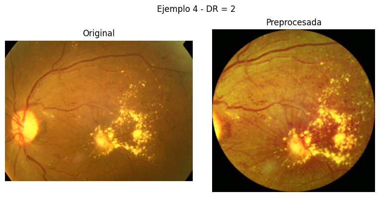
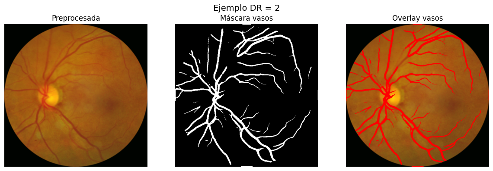
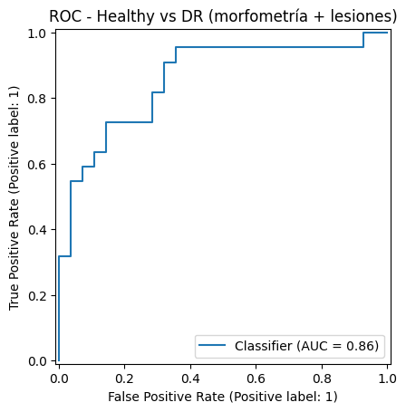

# Interpretable diabetic-retinopathy screening from retinal-vessel morphometry

Instead of an end-to-end CNN, this project builds an **interpretable pipeline**: segment the retinal vasculature,
quantify its morphology and visible lesions, and classify DR with gradient boosting + SHAP.

| Preprocessed fundus | Vessel mask + overlay |
|---|---|
|  |  |

## Pipeline
1. **Preprocessing** – circular crop, CLAHE on the green channel, resize.
2. **Vessel segmentation** with a pretrained **FCU-Net** (DRIVE weights, from [JavierGurrola/FCU-Net](https://github.com/JavierGurrola/FCU-Net) — third-party).
3. **Vascular features #1** – vessel area, skeleton length, end-points, bifurcations, fractal dimension, tortuosity (mean/max).
4. **Lesion features #2** – bright/dark lesion counts and areas via top-hat + Otsu.
5. **Models** – XGBoost multiclass (0–4), ordinal logistic (`mord`), and binary *healthy vs DR*; SHAP explanations per case.

## Results (single 75/25 stratified split, **n = 50 test images** from a 200-image subset)

| Task | Features / model | Accuracy | Other |
|---|---|---|---|
| Healthy vs DR | vessel morphometry · XGBoost | 0.72 | ROC-AUC 0.80 |
| Healthy vs DR | morphometry + lesions · XGBoost | **0.80** | **ROC-AUC 0.857** |
| 5-class DR grade | vessel morphometry · XGBoost | 0.60 | macro-F1 0.33 |
| 5-class DR grade | morphometry + lesions · XGBoost | 0.62 | macro-F1 0.26, QWK 0.44 |
| 5-class DR grade | morphometry + lesions · ordinal logistic (`mord`) | 0.56 | macro-F1 0.30, QWK 0.48 |



**Honest reading:** adding lesion features clearly helps the binary screen (AUC 0.80 → 0.857) but not the 5-class task; the binary screen is promising for such a small, hand-crafted-feature model, but with only 50 test images
confidence intervals are wide, and the multiclass model never predicts the rare severe grades (3–4) — class imbalance is the
main weakness. Model #3 in the notebook uses a tuned decision threshold that appears to be chosen on the same split, so treat
its numbers as optimistic. Next steps: stratified cross-validation on the full ~3,600 images, class weighting, external validation.

## Reproduce
```bash
pip install -r requirements.txt
# get APTOS 2019 data into data/ (see data/README.md)
jupyter notebook notebooks/retina_vascular_morphology_dr.ipynb
```

> **Note:** originally developed and run in Google Colab. Google-Drive mounting cells were removed, Drive paths were rewritten as relative paths and outputs were stripped (figures of the original run are in `assets/`). The paths/cleanup were **not re-executed** after this change, so expect to adjust paths.

## Author
Tiago Alejo Herrador
