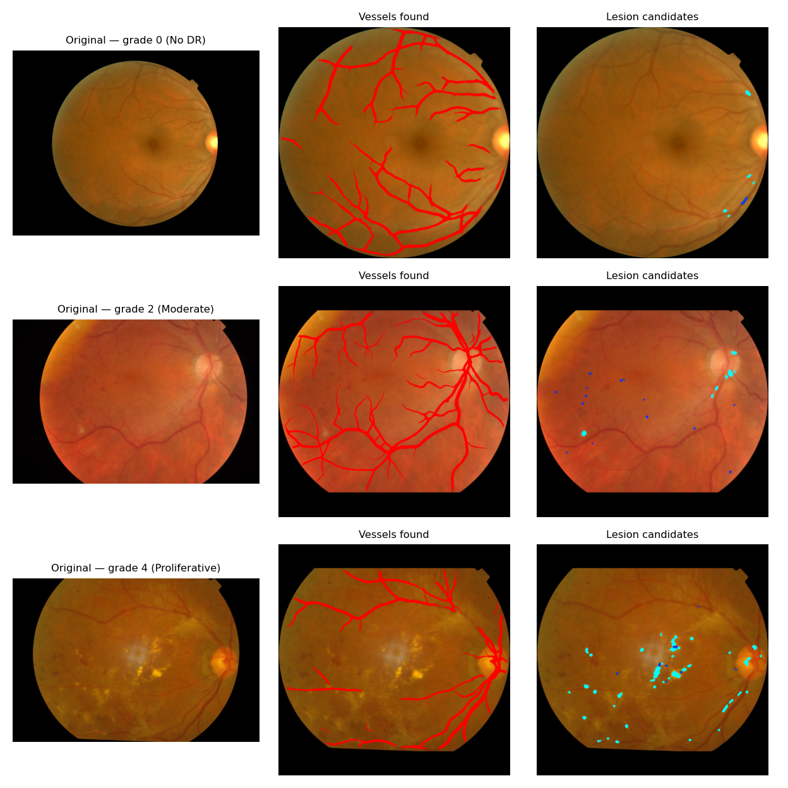
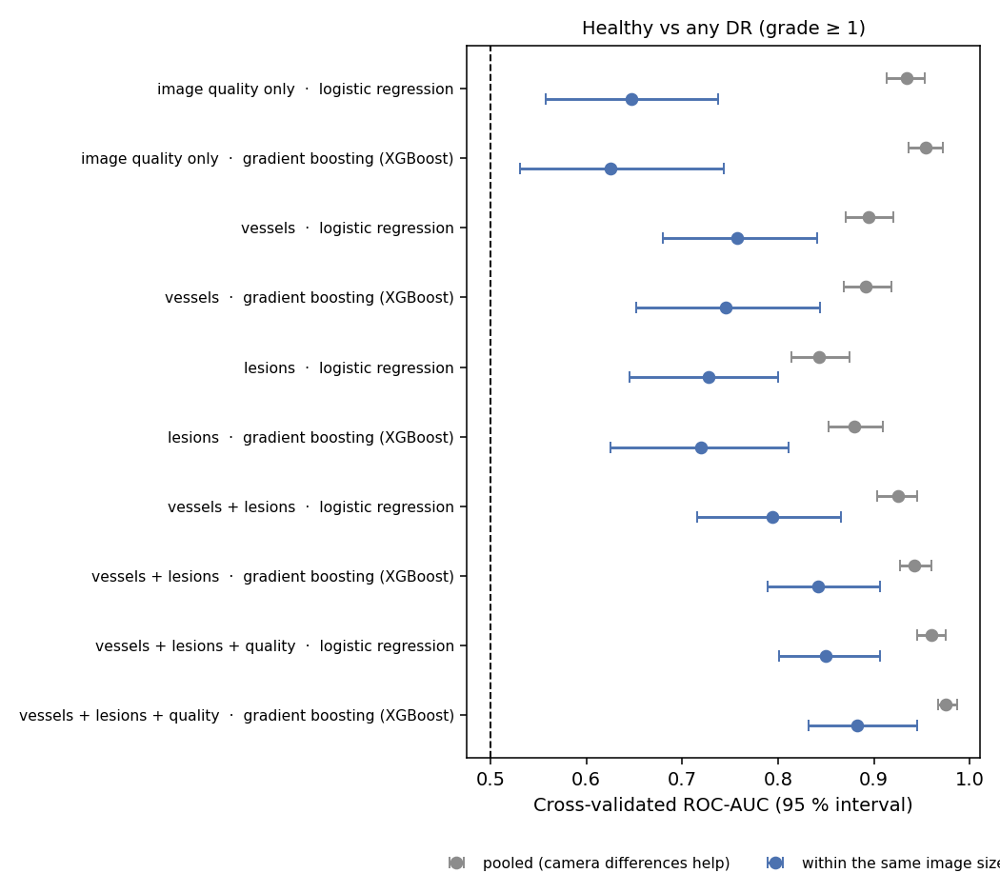
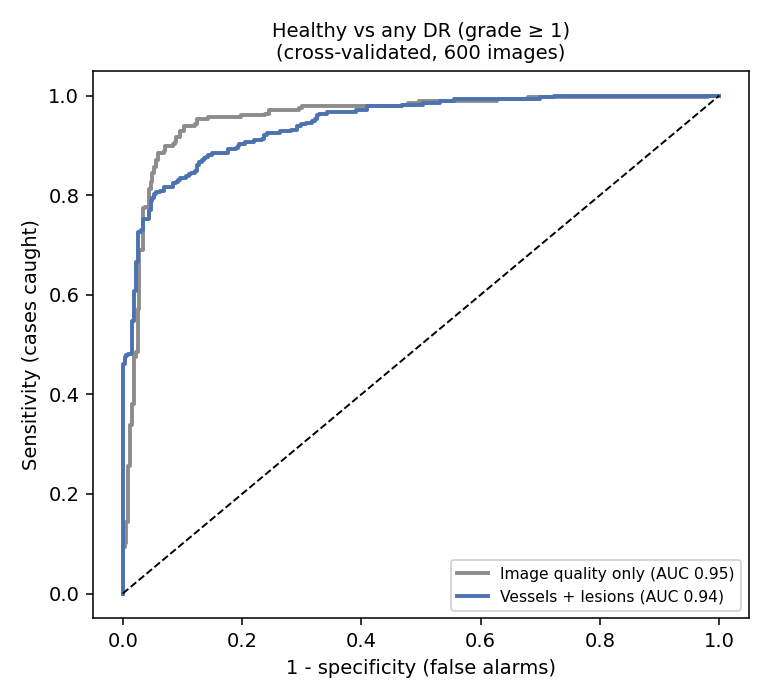
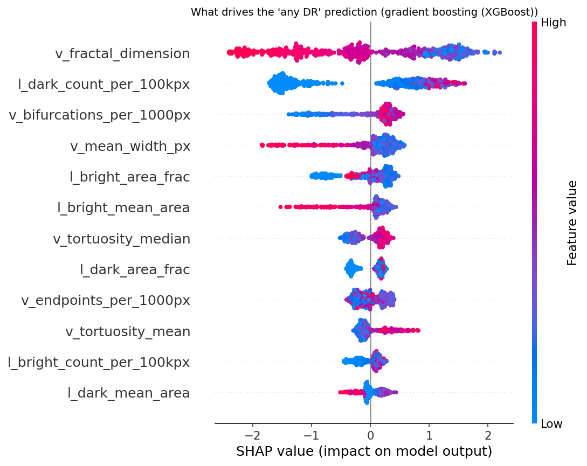
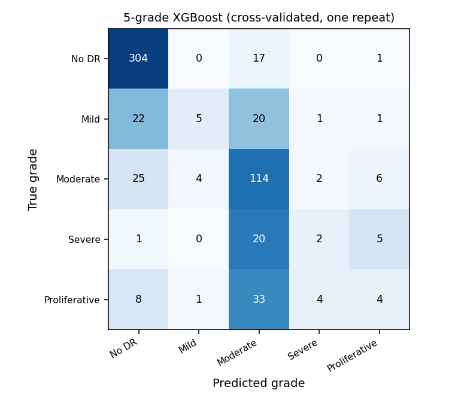
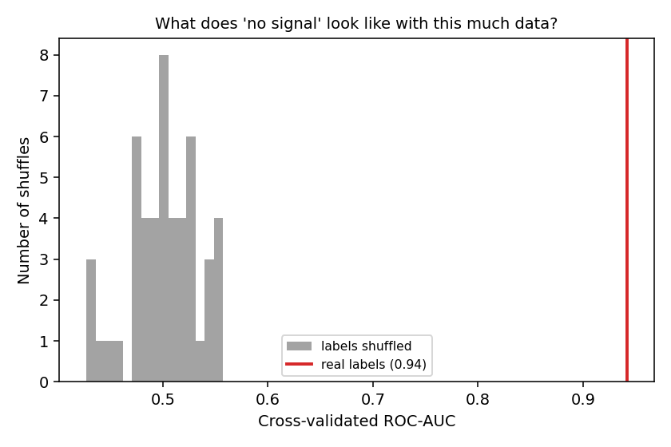

# Diabetic retinopathy from the shape of the retina's blood vessels

[](https://github.com/tiagoherrador/retina-vascular-dr/actions)

> **Research and portfolio project — not a medical tool.** It was built on public research data and has never been tested in a clinic. It must not be used to screen or diagnose anyone.

## What this project is

Diabetic retinopathy (DR) is damage to the retina caused by diabetes, and a leading cause of preventable blindness. It is found by looking at a photo of the back of the eye (a *fundus photograph*) for changes in the blood vessels and for small lesions.

Most automatic systems today are deep neural networks that give an answer but not a reason. I wanted to try the opposite: an **interpretable** pipeline that first *measures* things a clinician would recognise — how many vessels there are, how branched and winding they are, how many bright or dark spots appear — and then uses those measurements to decide.

Just as important, I wanted to see **how much of the result I can trust**. With a few hundred images it is very easy to get a pretty number that does not mean what it seems to. A good part of this project is the checks I added to find out, and one of them turned up something that changed how I read everything else.



## The short version

I used **600 photos** from the public APTOS 2019 collection (322 without DR and 278 with some degree of DR, graded 0–4 by clinicians).

| Question | What I found |
|---|---|
| Can the measurements tell healthy eyes from eyes with DR? | **Yes, reasonably well.** Among photos taken with the same image size, the model ranks a DR photo above a healthy one about **84 %** of the time (95 % interval 79–91 %). |
| Can it spot the cases that most need a specialist (moderate or worse)? | **Somewhat less well:** about **80 %** (75–86 %) within the same image size. |
| Is that just the camera? | **Partly it could have been, and I checked.** In this subset the *image size alone* nearly gives away the label, so I always report a "within the same image size" number next to the plain one. |
| What does a sensitivity-first setting look like? | Set to catch about 90 % of the cases, it clears about 76–86 % of the healthy photos (details below). |
| Can it tell the five grades apart? | **Only roughly.** It gets the order right fairly well (agreement score 0.65–0.69) but misses most of the rare severe grades. |

## How it works

1. **Find the retina.** Photos come from different cameras: some are cut at the top and bottom, some have wide black borders. The retina is located in each image, cropped, and resized to 512 × 512 pixels, and its contrast is enhanced.
2. **Find the vessels.** A pretrained neural network for retinal vessels (**FCU-Net**, from [another researcher's open-source work](https://github.com/JavierGurrola/FCU-Net), MIT licence) draws a vessel map. It was trained on other public datasets, not on these photos.
3. **Measure the vessels.** From the map I compute density, average width, branching points, the fractal dimension (how "space-filling" the vessel tree is) and how winding each branch is.
4. **Look for lesion candidates.** Simple filters pick out small bright spots (possible exudates) and small dark spots (possible microaneurysms or haemorrhages), ignoring the vessels.
5. **Decide.** A small model (logistic regression or gradient boosting, XGBoost) turns the measurements into a probability, and SHAP shows which measurements pushed it up or down.

Every measurement is taken **inside the retina** and expressed per unit of retina (for example, vessel density rather than vessel pixels), so a photo with a bigger black border is not mistaken for a different eye.

## A trap I found: the image size gives away the answer

APTOS photos were taken with different cameras at different clinics, and the image size is a good fingerprint of the source. In my 600 photos the size alone says a lot about the diagnosis:

| Image size | Healthy | With DR | % with DR |
|---|---|---|---|
| 1050 × 1050 | 160 | 10 | 6 % |
| 2416 × 1736 | 8 | 91 | 92 % |
| 2588 × 1958 | 41 | 41 | 50 % |
| 3216 × 2136 | 2 | 66 | 97 % |
| 2048 × 1536 | 61 | 0 | 0 % |
| 819 × 614 | 48 | 2 | 4 % |

(14 different sizes in total; the full table is in `results/image_size_vs_label.csv`.)

So a model can score well just by recognising the camera. To see how big that effect is, I trained the same models on **image-quality features only** (size, brightness, contrast, sharpness) — no vessels, no lesions — and I report two numbers for everything:

- **Pooled** — all images together. The camera can help here.
- **Within the same image size** — I compare only photos of the same size with each other and then average. This answers: *given two photos from the same camera, one with DR and one without, how often does the model score the DR one higher?* It cannot be fooled by the camera (nearly), but it only uses the sizes that contain both kinds of photo (351 of the 600 images for "any DR").

*How to read this number (the "AUC").* 0.5 means a coin flip and 1.0 means always right. 0.7–0.8 is fair, above 0.8 is good.

## Results: healthy vs any DR

I used repeated 5-fold cross-validation (the images are split into five groups; each group is tested by a model trained on the other four; this is repeated three times). Photos of the same eye never end up on both sides of a split — I found two such duplicated pairs, one of them with *different* grades in the two copies (3 and 2).



| Measurements used | Model | Pooled AUC | Within the same size |
|---|---|---|---|
| Image quality only (no eye information) | XGBoost | 0.95 | **0.63** |
| Vessels | logistic regression | 0.90 | 0.76 |
| Lesions | XGBoost | 0.88 | 0.72 |
| **Vessels + lesions** | **XGBoost** | **0.94** (0.93–0.96) | **0.84** (0.79–0.91) |
| Vessels + lesions + image quality | XGBoost | 0.98 | 0.88 |

- Image quality alone reaches **0.95 pooled**: that is the camera shortcut. Within the same size it falls to **0.63**.
- The vessel and lesion measurements keep a clear signal **within the same size (0.84)**. That is the number I would quote.
- Vessels and lesions complement each other: together they do better than either alone.



## Results: moderate or worse DR ("referable")

Clinicians usually decide whether to send a patient to a specialist when DR is **moderate or worse** (grade ≥ 2), so I repeated the analysis for that question.

| Measurements used | Model | Pooled AUC | Within the same size |
|---|---|---|---|
| Image quality only | XGBoost | 0.92 | 0.58 |
| Vessels | XGBoost | 0.86 | 0.75 |
| Lesions | logistic regression | 0.85 | 0.73 |
| **Vessels + lesions** | **XGBoost** | **0.92** (0.90–0.94) | **0.80** (0.75–0.86) |

It is a bit harder than the any-DR question within the same camera (0.80 vs 0.84). The full tables, with intervals, are in `results/cv_auc.csv`.

## A sensitivity-first setting

A screening tool should miss as few cases as possible. I asked for a threshold that catches **at least 90 % of the cases**, and I chose that threshold **inside the training part of each fold**, never looking at the images it is then reported on. (Picking it on the test images makes the result look better than it is.)

| Question | Photos used | Cases caught (sensitivity) | Healthy cleared (specificity) |
|---|---|---|---|
| Any DR | all 600 | 90 % (86–93 %) | 79 % (75–84 %) |
| Any DR | only image sizes with both healthy and DR photos | 88 % (82–92 %) | 86 % (80–90 %) |
| Moderate or worse | all 600 | 89 % (85–93 %) | 76 % (71–80 %) |
| Moderate or worse | only image sizes with both kinds | 90 % (84–94 %) | 80 % (74–84 %) |

These numbers are **indicative**: the camera can still help a little through the threshold, so I would not read them as what a clinic would see. For context, an approved screening system was tested prospectively in a 900-patient trial against pre-set targets of about 85 % sensitivity and 82.5 % specificity ([Abràmoff 2018](docs/references.md)); it is a different task and a different kind of system, so this is context, not a benchmark.

## Which measurements matter?



*How to read it:* each dot is one photo; to the right the measurement pushes the prediction towards "DR", to the left towards "healthy"; red means a high value, blue a low one. This shows what the model learned from **all photos together**, so it also contains camera differences (see the next paragraph).

To see which measurements separate the two groups **among photos of the same size**, I also looked at them one at a time (`results/single_feature_auc.csv`; 0.5 means no separation, and values far from 0.5 in either direction mean separation):

| Measurement | Within-size AUC | In words |
|---|---|---|
| Dark-spot size, area and count | 0.75 – 0.79 | more dark spots in photos with DR |
| Vessel skeleton density | 0.21 (i.e. 0.79 reversed) | fewer vessels detected in photos with DR |
| Fractal dimension | 0.23 (0.77 reversed) | a less "filled" vessel tree in DR |
| Vessel density | 0.27 (0.73 reversed) | fewer vessels detected in DR |
| Mean vessel width | 0.73 | wider vessels in DR (but the opposite when all photos are pooled: a camera effect) |
| Tortuosity (how winding) | 0.56 – 0.60 | weak |

Two honest remarks. First, "fewer vessels detected" does not necessarily mean "fewer vessels": hazy images, poor contrast or bright lesions can also make the vessel map thinner. I did not test which it is. Second, tortuosity, which is the classical vascular marker, is among the weakest signals here.

## Results: the five grades

Telling the five grades apart is much harder with 600 images, because the severe grades are rare (28 photos of grade 3 and 50 of grade 4).



| Model | Accuracy | Macro-F1 | Agreement score (QWK) |
|---|---|---|---|
| Always predict the most common grade (no eye information) | 0.54 | 0.14 | 0.00 |
| XGBoost, five classes | 0.70 | 0.37 | 0.65 |
| Ordinal logistic regression | 0.65 | 0.38 | 0.69 |

The *agreement score* (quadratic weighted kappa) counts a mistake of one grade as less serious than a mistake of three: 0 is chance and 1 is perfect. Restricted to image sizes with both kinds of photo it stays about the same (0.65–0.66). Even so, the model gets most of the mild and severe photos wrong (see the matrix), so I would not use it to grade DR.

## Is this just luck?

I re-ran the whole cross-validation 50 times with the labels shuffled. On shuffled labels the AUC stays around 0.50 (highest 0.56); within the same size the shuffled values reach at most 0.58. The real results (0.94 pooled and 0.84 within size) are above all 50 shuffles in both cases (p ≈ 0.02, the smallest value 50 shuffles can give).



## Things to keep in mind

- **Small, single-source data.** 600 photos from one public collection, with cameras that are strongly tied to the diagnosis. The "within the same size" numbers are my best guess of what survives, but image size is only a *proxy* for the camera, and some differences between cameras remain.
- **Only a few sizes contain both healthy and DR photos,** so the within-size numbers use 351 (any DR) or 419 (moderate or worse) of the 600 images and lean on a handful of cameras.
- **No external check.** I did not test on another dataset (EyePACS, Messidor-2, IDRiD…). That would be the real test.
- **The vessel network was not trained on these photos,** and there are no vessel annotations for APTOS, so I cannot say how accurate the vessel maps are; I checked them by eye on examples.
- **The lesion detectors are simple filters I wrote,** not validated against lesion annotations. They also pick up some false spots (parts of the optic disc, reflections on vessels).
- **Labels are noisy.** Clinical grades have disagreement between graders, and I found a duplicated eye with two different grades.
- **Not a diagnosis.** Nothing here covers macular oedema or other eye diseases, and I did not compare against a deep neural network trained on the same photos, which would probably score higher.
- **I used a subset** (600 of the 3,662 APTOS training images) because that is what I had on disk.

## Try it yourself

You need the APTOS 2019 images and `train.csv` from Kaggle (see [data/README.md](data/README.md)); I cannot redistribute them.

```bash
pip install -e ".[fcunet,explain,ordinal,dev]"

retina-extract  --csv data/train.csv --images data/images --out results/features.csv   # about 3 s per photo
retina-evaluate --features results/features.csv --out results                          # tables and figures
retina-example  --csv data/train.csv --images data/images                              # the example figure
pytest -q                                                                              # automated tests
```
The vessel-network weights (1.8 MB) are downloaded on the first run and checked against a fingerprint; see [models/README.md](models/README.md). If you cannot install PyTorch, `--segmenter classical` uses a simpler filter instead.

<details>
<summary><b>For developers</b></summary>

**Code layout** (`src/retina_dr/`): `preprocess.py` (find the retina, crop, pad, CLAHE) · `vessels.py` (FCU-Net wrapper with checksum-verified weights; classical Sato-filter fallback) · `fcunet.py` (vendored network, MIT) · `features.py` (vessel morphometry, lesions, image quality, duplicate hash) · `evaluate.py` (repeated stratified/grouped CV, nested sensitivity threshold, bootstrap and Wilson intervals, within-stratum AUC, permutation null) · `data.py` · `plots.py` · `extract_cli.py`, `evaluate_cli.py`, `example_cli.py`.

**Protocol.** Repeated stratified 5-fold CV (3 repeats), folds stratified on label × image size and grouped by near-duplicate vessel pattern (256-bit hash; two duplicate pairs found). Probabilities are out-of-fold, so every image is scored by a model that never saw it. The sensitivity-first threshold comes from an inner 3-fold CV inside each training fold. AUC intervals are bootstrap over images (repeat-averaged probabilities); sensitivity/specificity use Wilson intervals. The within-size AUC is the pair-weighted average of per-size AUCs over sizes with ≥ 5 healthy and ≥ 5 DR images. The final model for each question is the better of two candidates by within-size AUC, so the reported AUC is slightly optimistic for having chosen between them. The permutation test shuffles labels (within sizes for the within-size AUC) and reruns the whole CV.

**Tests** (`pytest -q`, 22): a straight diagonal vessel has tortuosity 1 and a wavy one more; a Y-shaped tree has 3 endpoints, 1 bifurcation and 3 branches; densities are per unit of retina; the retina is found off-centre; lesion detectors ignore vessels; the within-size AUC is not fooled by a camera shortcut that fools the pooled AUC; cross-validation finds planted signal and sits at 0.5 on noise; permutation nulls are centred on 0.5; the decision threshold never uses the held-out fold; duplicate groups never straddle a fold; the FCU-Net forward pass has the right shape.

**Design decisions and the literature behind them:** [docs/design_decisions.md](docs/design_decisions.md) · [docs/references.md](docs/references.md). The first exploratory notebook is kept with its outputs in [`notebooks/exploratory/`](notebooks/exploratory).

</details>

## Author
Tiago Alejo Herrador — MIT licensed. The FCU-Net code and weights are © 2022 Javier Gurrola-Ramos (MIT; see [docs/FCU-Net_LICENSE.txt](docs/FCU-Net_LICENSE.txt)).
